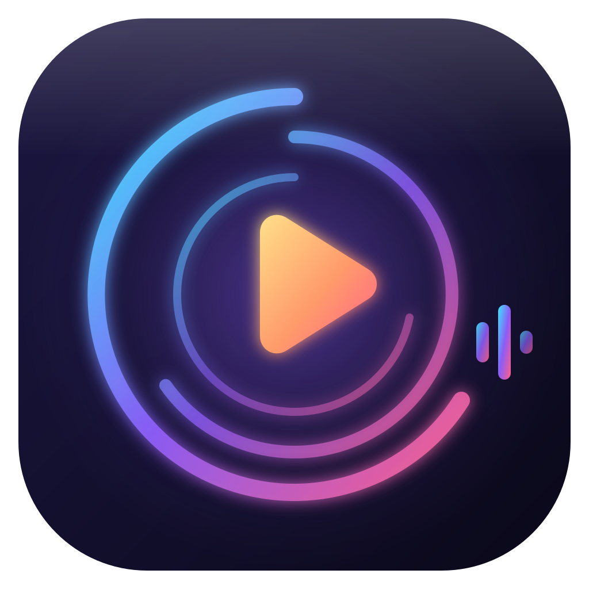

<p align="center">
  
</p>

<h1 align="center">MultimediaMX</h1>

<p align="center">
  Reproductor multimedia libre, elegante y multiplataforma.<br/>
  Audio y video locales · Listas M3U/M3U8 · Ecualizador de 10 bandas · Letras sincronizadas · 3 interfaces
</p>

<p align="center">
  <a href="LICENSE"></a>
  
</p>

---

## Descargas

Los instaladores se generan automáticamente en **[Releases](https://github.com/chago2850-blip/MultimediaMX/releases)**:

| Sistema | Archivo |
|---|---|
| Windows 10/11 (64 bits) | `MultimediaMX-x.y.z-Windows-Setup.exe` |
| macOS Apple Silicon (M1–M4) | `MultimediaMX-x.y.z-macOS-arm64.dmg` |
| macOS Intel | `MultimediaMX-x.y.z-macOS-x64.dmg` |
| Linux (cualquier distribución) | `MultimediaMX-x.y.z-Linux-x86_64.AppImage` |
| Debian / Ubuntu / Mint | `multimediamx_x.y.z_amd64.deb` |
| Android 7.0 o superior | `MultimediaMX-x.y.z-Android.apk` |

> **macOS:** la app no está firmada por Apple. La primera vez haz clic derecho → **Abrir**, o ejecuta `xattr -cr /Applications/MultimediaMX.app`.
> **Android:** permite instalar apps de «orígenes desconocidos».

## Funciones

- **Casi cualquier formato.** En escritorio se reproducen de forma nativa MP3, AAC/M4A, FLAC, OGG/Opus, WAV, MP4, MKV, WebM y MOV; todo lo demás (AVI, WMV, FLV, MPG, VOB, TS, 3GP, RMVB, WMA, APE, AIFF, AC3, DTS, ALAC, WavPack…, o un MKV con audio AC3/DTS) se **convierte al vuelo con FFmpeg**, que viene incluido. Si un archivo «nativo» falla, se reintenta convirtiéndolo automáticamente.
- **Listas M3U / M3U8.** Importa listas (extendidas o simples, rutas relativas o absolutas, `file://`, URLs de radio e IPTV con `tvg-logo` y `group-title`), crea tus propias listas, reordénalas arrastrando y exporta a `.m3u8`.
- **Ecualizador de 10 bandas** (31 Hz – 16 kHz, ±12 dB) con curva de respuesta, 14 preajustes (Rock, Pop, Jazz, Clásica, Electrónica, Latina, Cine…), preajustes propios, preamplificador, balance y limitador contra saturación.
- **Letras en línea** cuando hay conexión: LRCLIB (letras sincronizadas línea por línea) y lyrics.ovh como respaldo. También lee letras incrustadas en las etiquetas y archivos `.lrc` junto a la canción. Funciona con canciones **y videos** (deduce artista y título del nombre del archivo, p. ej. `Artista - Canción (Video Oficial).mp4`). Toca una línea para saltar a ese momento; puedes corregir la búsqueda a mano.
- **Tres interfaces intercambiables** (Ajustes → Interfaz, o el botón de paleta):
  - **Aurora:** oscura y luminosa, portada grande con anillo de espectro y fondo teñido por la carátula.
  - **Vinilo:** cálida y clásica, tocadiscos animado con brazo y tipografía con serifas.
  - **Estudio:** clara y técnica, pantalla tipo LCD, ecualizador y analizador de espectro siempre visibles.
- **Video:** subtítulos `.srt`/`.vtt` externos y pistas de subtítulos incrustadas, selección de pista de audio, pantalla completa.
- Biblioteca con búsqueda instantánea, orden por columnas y lista virtual para miles de pistas; cola editable; aleatorio y repetición; velocidad de reproducción; mini reproductor siempre visible; teclas multimedia del sistema; arrastrar y soltar; «Abrir con…» desde el explorador; recuerda la cola y la posición al cerrar.
- Interfaz en **español** e **inglés**.

### Atajos de teclado

| Tecla | Acción |
|---|---|
| Espacio | Reproducir / pausa |
| ← / → (Shift: 30 s) | Retroceder / avanzar 5 s |
| ↑ / ↓ | Volumen |
| N / P | Siguiente / anterior |
| L | Letra |
| S / R | Aleatorio / repetir |
| F | Pantalla completa (video) |
| / | Buscar |

## Notas por plataforma

- **Android:** «Buscar en el dispositivo» lee la biblioteca de música y videos del teléfono (pide permiso). Reproduce los formatos que admite Android (MP3, AAC, FLAC, OGG/Opus, WAV, MP4, MKV, WebM, 3GP…); los formatos que requieren FFmpeg (AVI, WMV, WMA…) solo se convierten en la versión de escritorio. Las listas M3U con rutas relativas se resuelven buscando el archivo por nombre en la biblioteca.
- **Radios e IPTV:** las transmisiones de listas M3U se reproducen directamente; en escritorio también pasan por el ecualizador.

## Compilar desde el código

Requisitos: Node.js 22 o superior.

```bash
npm install
npm start              # compila la interfaz y abre la app de escritorio
npm test               # pruebas (M3U, letras, subtítulos)
npm run dist:linux     # AppImage y .deb   (también dist:win y dist:mac)
npm run android:sync   # prepara el proyecto Android; luego: cd android && ./gradlew assembleDebug
npm run icons          # regenera iconos a partir de public/logo.svg
```

**Publicar una versión nueva:** sube el número de `"version"` en `package.json` (por ejemplo a `1.0.1`) y haz push a `main`. GitHub Actions compila los instaladores de las cuatro plataformas y publica el Release `v1.0.1` automáticamente (unos 10 minutos). Si la versión ya tiene Release, solo se compilan los artefactos de prueba.

### Estructura

```
electron/        proceso principal: servidor local con Range, FFmpeg, listas, metadatos
src/core/        reproductor, ecualizador, letras, M3U y adaptador de plataforma
src/ui/          vistas, ecualizador gráfico, pantalla de reproducción
src/styles/      estilos base y las tres interfaces
android/         proyecto Capacitor con el complemento nativo MediaLibrary
public/logo.svg  logo original de MultimediaMX
```

## Licencia

Copyright © 2026 **Santiago Miguel** — 744 354 8848 — chago2850@gmail.com

MultimediaMX es software libre: puedes redistribuirlo y/o modificarlo bajo los términos de la
**Licencia Pública General GNU**, publicada por la Free Software Foundation, ya sea la **versión 3**
de la Licencia o (a tu elección) **cualquier versión posterior**. Se distribuye con la esperanza de
que sea útil, pero **SIN NINGUNA GARANTÍA**. Consulta el archivo [LICENSE](LICENSE).

Componentes de terceros: Electron (MIT), FFmpeg (GPL, binarios de `ffmpeg-static`),
music-metadata (MIT), Capacitor (MIT). Las letras provienen de [LRCLIB](https://lrclib.net) y
[lyrics.ovh](https://lyrics.ovh); su contenido pertenece a sus autores.
